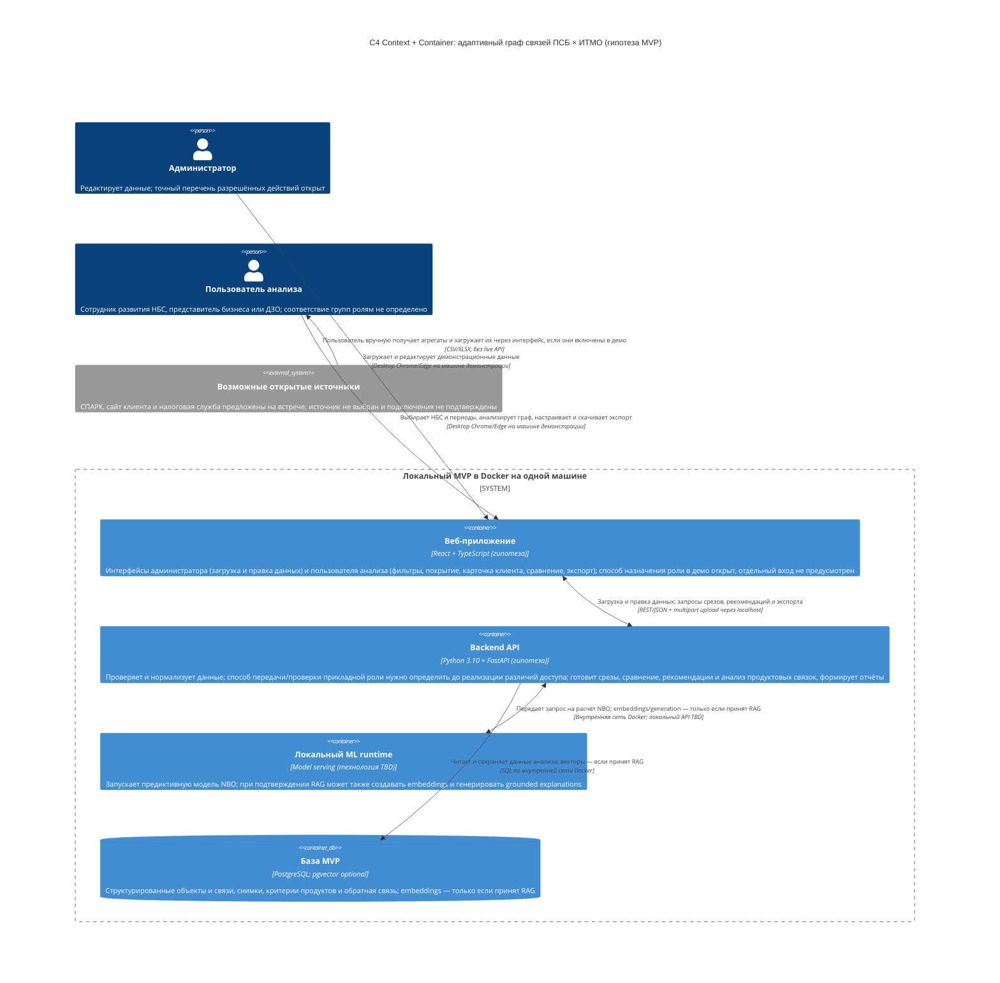

# C4 Architecture: адаптивный граф связей ПСБ × ИТМО

> **Версия:** 0.6 — синхронизация с API Inventory и анализом продуктовых связок  
> **Дата:** 2026-11-18  
> **Уровни:** C4 Context + Container  
> **Основание:** `artifacts/brief.md`, `artifacts/usm.md`, `artifacts/nfr.md`, `artifacts/schema.xlsx`, `artifacts/stakeholder.docx`, `../TeamPink/transcripts/псб-18-11/псб-18-11.md`

Обозначения в документе:

- **Факт** — зафиксирован в проектных материалах или решениях пользователя.
- **Гипотеза** — предлагаемое архитектурное решение для первой реализации; команда может его изменить.
- **Открыто** — параметр пока не выбран и не должен считаться согласованным.

## 1. Обзор системы

**Назначение — факт.** После встречи MVP ограничен одним сценарием наполненности текущего клиентского портфеля выбранным НБС: просмотр клиентского покрытия, анализ применимости и рекомендаций, просмотр продуктовых связок, сравнение периодов и экспорт графа/отчёта. Иерархия владения холдингами, дочерними и внучатыми компаниями в сценарий не входит.

**Аудитория и права — факт.** Бизнес-группы пользователя — сотрудники развития НБС, бизнес и ДЗО. На встрече заказчик дополнительно назвал прикладные роли: администратор может редактировать данные, вторая роль использует анализ. Для локального MVP ранее подтверждён запуск без отдельного входа. Матрица прав, сопоставление бизнес-групп с ролями и способ назначения прикладной роли в демо не определены.

**Профиль MVP — факт.** Семестровый демонстрационный прототип с загрузкой Excel/CSV, полностью синтетическими клиентскими данными и выбранным контекстом из открытого источника. Заказчик отказался передавать клиентские записи и принял, что синтетика показывает работу сценария и pipeline, но не качество рекомендаций на реальном портфеле. Реальные конфиденциальные банковские данные и подключение к банковским системам в текущую демонстрацию не включены. Отдельный вход в локальное демо не предусмотрен; способ назначения роли для проверки разделения действий открыт.

**Демонстрационные данные — решение команды после отказа заказчика предоставить данные.** Команда подготовит полностью синтетический набор по структуре из `schema.xlsx`. Набор должен поддерживать сравнение двух временных периодов. Он не копирует реальные данные клиентов; для ДМС положительная рекомендация показывается только после получения правил применимости.

**Объём данных — ориентир, не цель бенчмарка.** На встрече заказчик оценил клиентскую часть витрины примерно в 500 тысяч записей. Команда упомянула 100 тысяч синтетических наборов параметров, но размер эталонного набора не согласован. Архитектурная гипотеза: в браузер отдавать только выбранный фильтрами срез и агрегаты, а не весь клиентский портфель сразу.

**Архитектурное направление — гипотеза.** Веб-клиент, единый backend API, локальный ML runtime и одна PostgreSQL-база запускаются Docker-контейнерами на одной демонстрационной машине. pgvector добавляется только если команда подтвердит векторный retrieval. Схема графа хранится как структурированные объекты и связи; отдельная graph DB не предполагается.

**RAG — открытая гипотеза пользователя.** Документы компании могут стать источниками данных, а векторизация может помочь искать релевантные фрагменты. Объём, форматы документов, необходимость RAG и его место в MVP не решены. Локальный ML runtime остаётся архитектурной гипотезой для требуемого предиктивного NBO; embeddings и LLM будут добавлены туда только при подтверждении RAG.

**Демонстрационный НБС — решение пользователя.** Выбрано «Страхование → ДМС». В `schema.xlsx` есть этот подтип, но нет критериев применимости. Их нужно запросить до показа положительной рекомендации; пока критерии не заданы, система показывает «данных недостаточно». «Правокард» упомянут в брифе как пример, но отсутствует в перечне банковских продуктов из схемы.

## 2. Архитектурная диаграмма

Диаграмма намеренно не показывает соединение с Hadoop, банковскими витринами или банковской платформой: в материалах это возможное целевое окружение после MVP, а не интеграция семестрового прототипа.

## 3. Описание контейнеров

| Контейнер | Технология | Назначение | Масштабирование MVP |
|---|---|---|---|
| Веб-приложение | **Гипотеза:** React + TypeScript; библиотека графа не выбрана | Интерфейс администратора для импорта и правки данных; интерфейс анализа для фильтров, графа покрытия, карточки клиента, сравнения периодов, объяснения/отметки рекомендации, выбора экспортируемых полей и запуска экспорта | Один демонстрационный экземпляр в Docker; клиент рисует выбранный и отфильтрованный срез |
| Backend API | **Гипотеза:** Python 3.10 + FastAPI. Python 3.10 упоминается в ТЗ как среда будущего использования; FastAPI — наше предварительное решение | Приём и проверка Excel/CSV; сопоставление полей; чтение/сохранение версий; выдача отфильтрованного покрытия и агрегатов; сравнение периодов; анализ наблюдаемых продуктовых связок; применение продуктовых критериев; оркестрация NBO; сохранение обратной связи; подготовка отчётов. Проверка различий прав зависит от ещё не выбранного способа назначения роли в локальном демо | Один процесс/экземпляр для демонстраций. Объём мокового набора и допустимая задержка TBD; запросы должны возвращать выбранный срез, не всю базу |
| Локальный ML runtime | **Гипотеза:** отдельный контейнер model serving на той же машине | Выполняет локальный предиктивный расчёт NBO. Если команда примет RAG, тот же runtime может обслуживать локальные embeddings/LLM либо быть разделён после технической проверки | Один контейнер; конкретная модель и потребление RAM/CPU/GPU требуют проверки на демонстрационной машине |
| База MVP | **Гипотеза:** PostgreSQL в отдельном контейнере; pgvector — опционально при подтверждении RAG | Хранение узлов/связей и периодических снимков, критериев применимости, рекомендаций и обратной связи. При RAG хранит также текстовые фрагменты и embeddings | Один экземпляр на машине демонстрации. Размер мокового набора нужно проверить. Если команда примет векторный поиск, pgvector позволяет хранить векторы в PostgreSQL и сочетать его с полнотекстовым поиском ([документация проекта](https://github.com/pgvector/pgvector)) |

**Развёртывание — решение пользователя:** контейнеры запускаются на одной демонстрационной машине через Docker. **Гипотеза:** для совместного запуска использовать Docker Compose; host OS и доступность нужных ресурсов локальной модели ещё нужно проверить.

### Логические модули внутри Backend API

Это модули одного приложения, не отдельные C4-контейнеры:

- **Import & validation:** чтение Excel/CSV, проверка ИНН, пропусков и дублей, сопоставление колонок и идентификаторов.
- **Graph & snapshots:** узлы, связи, выбранный период, получение подграфа и сравнение двух снимков.
- **Product associations & bundles:** просмотр совместной встречаемости продуктов по срезу и связок, описанных в исходных сведениях. Совместная встречаемость не подтверждает применимость или коммерческие условия; метрики обнаружения связок TBD.
- **Text retrieval (RAG — открытый вопрос):** если гипотеза подтвердится, модуль будет разбивать допустимые текстовые источники на фрагменты, создавать embeddings локальным runtime и возвращать найденные фрагменты с происхождением. Объём корпуса и форматы документов не решены.
- **Applicability & recommendations:** состояния применимости, исключающие факторы, причины и порядок рекомендаций. RAG добавляет текстовые свидетельства, но не подменяет правила продукта или оценку вероятности Next Best Offer. Алгоритм NBO и метрика его качества пока не выбраны.
- **Feedback:** сохранение статуса «принята / отложена / нерелевантна» и причины; автоматическое переобучение на отметках не предполагается.
- **Export:** **гипотеза границ:** веб-клиент экспортирует текущее представление графа, чтобы сохранить выбранный масштаб, позицию и подсветку; backend формирует аналитический отчёт PDF/PPTX по выбранным данным и фильтрам. Поддержку каждого формата графа нужно проверить с выбранной библиотекой визуализации.

## 4. Внешние системы и источники

| Система/источник | Назначение | Интеграция в MVP | Fallback |
|---|---|---|---|
| Синтетический Excel/CSV команды | Тестовые записи действующих клиентов и продуктов для одного сценария наполненности НБС | Команда генерирует файл по `schema.xlsx`, минимум с двумя периодами. Реальные имена, ИНН и клиентские записи не используются. Объём набора не выбран | Повторная генерация из фиксированной схемы/seed или заранее подготовленный fixture |
| Документы компании с текстовым содержимым | Возможные источники сведений о клиенте, конкурентах и условиях | Документы как источники данных — гипотеза пользователя. RAG и чтение PDF/других форматов не утверждены; подтверждённый файловый сценарий MVP пока ограничен XLSX/CSV | Если RAG не войдёт в MVP, анализировать доступные структурированные поля и заметки обычной логикой |
| Возможные открытые источники: СПАРК, сайт клиента, налоговая служба | Открытый контекст для демонстрации вместе с синтетическими клиентскими данными | Пользователь подтвердил использование открытых данных в демонстрации; заказчик предложил кандидатов. Источник, доступ и разрешение не подтверждены. **Гипотеза:** выбранный контекст подготовить как отдельный файл без live API | Требуется выбрать доступный источник до демо; агрегаты не связывать с отдельными синтетическими клиентами |
| Hadoop, банковские витрины, банковская платформа | Возможные внутренние источники и целевое окружение из ТЗ | Не подключаются в текущем MVP; реальные банковские данные не используются | Подготовленные/синтетические данные |

## 5. Потоки данных

### Основной поток

1. Администратор загружает Excel/CSV через веб-интерфейс.
2. Backend проверяет структуру и идентификаторы, нормализует данные и возвращает результат импорта с ошибками и неоднозначными сопоставлениями.
3. Подтверждённый синтетический набор сохраняется как снимок с датой и источником «синтетические данные».
4. Пользователь анализа выбирает НБС, период и фильтры; backend возвращает выбранный срез клиентского покрытия и агрегаты, не всю базу, и обращается к локальному ML runtime для демонстрации скоринга/ранжирования NBO.
5. Если для продукта не заданы критерии или структурированных данных не хватает, система возвращает состояние «данных недостаточно». Найденные текстовые фрагменты служат источниками пояснений, но сами по себе не подтверждают применимость. Отметки пользователя и причины сохраняются отдельно от логики модели.
6. Пользователь сравнивает два снимка, выбирает поля для экспорта и получает файл, соответствующий текущему экранному представлению, а также аналитический отчёт.

### Поток открытых данных

Пользователь ожидает открытый контекст в демонстрации; заказчик на встрече назвал СПАРК, сайт клиента и налоговую службу, но не выбрал их. **Гипотеза:** после выбора и проверки условий использования контекст готовится как отдельный файл, а не через live API. Если выбраны агрегаты, их происхождение и дата фиксируются; агрегаты не приписываются отдельным синтетическим компаниям без подтверждённого соответствия.

### Обработка и хранение файлов

**Гипотеза:** исходный загруженный файл временно обрабатывается backend; нормализованные данные и метаданные снимков сохраняются в Docker volume до ручной очистки после демонстрации. Срок хранения исходного файла нужно решить перед реализацией импорта. Экспортируемые файлы возвращаются пользователю по запросу и постоянно не хранятся.

## 6. Ключевые решения-гипотезы

| Решение | Гипотеза | Почему | Альтернатива / условие пересмотра |
|---|---|---|---|
| Число развёртываемых компонентов | Один веб-клиент, один backend, один локальный ML runtime и одна база | Семестровый прототип, подготовленные данные, нет утверждённых интеграций или требований к промышленной эксплуатации | Объединить ML runtime с backend, если выбранная модель и зависимости не требуют отдельного контейнера; разделять компоненты при появлении независимого масштабирования или долгих фоновых вычислений |
| Обмен UI и backend | REST/JSON; загрузка файла multipart; ответы с экспортом как download | Достаточно для фильтров, загрузки, сравнения и экспорта; real-time сценарий не задан | WebSocket/очередь только при появлении live-обновлений или долгих расчётов |
| Backend | Python 3.10 + FastAPI | Python 3.10 указан в ТЗ для целевого окружения; FastAPI — лёгкая гипотеза для API MVP | Другой Python web framework, если команда уже имеет заготовку или опыт, снижающий срок разработки |
| Запуск | Docker на одной демонстрационной машине — решение пользователя; Docker Compose — гипотеза | Контейнеризация фиксирует одинаковый способ запуска web, API, ML runtime и DB | Уточнить только, доступен ли Docker на выбранной машине и хватает ли ей ресурсов |
| База | PostgreSQL; pgvector — только при подтверждении RAG | PostgreSQL покрывает структурированные объекты, связи, снимки, критерии и обратную связь. pgvector добавляет хранение/поиск embeddings в той же БД ([документация проекта](https://github.com/pgvector/pgvector)) | Если размер/нагрузка потребуют, отдельно сравнить векторное хранилище; пока отдельный сервис не добавляется |
| RAG | Открытая гипотеза пользователя; не включена в обязательный сценарий до проверки | Документы могут стать источниками данных; RAG — один из способов искать фрагменты, но необходимость, корпус и поддерживаемые форматы пока не определены | Проверить ценность на ограниченном наборе после определения документа и задачи пользователя |
| AI runtime | Локальный model serving — предпочтительное архитектурное направление; конкретный рантайм и модели TBD | Пользователь выбрал запуск моделей на демонстрационной машине; это соответствует предиктивному NBO и не требует внешнего model API | Выбрать runner после проверки модели, Docker-образа, ресурсов машины и качества на контрольных примерах |
| Экспорт | Веб-клиент формирует файлы текущего графа; backend формирует аналитические PDF/PPTX отчёты | Заказчик просит выбирать поля перед экспортом и сохранять вид, который пользователь просматривает | Проверить форматы графа и воспроизведение выбранного состояния после выбора библиотеки визуализации; размер страницы A4 не фиксировать из-за неясной расшифровки |
| Хранение демо-данных | Нормализованные снимки и обратная связь сохраняются в Docker volume до ручной очистки после демонстрации; исходные загрузки и экспорты временные | История нужна для сравнения периодов и обратной связи; демо использует синтетические данные | Сроки хранения и очистки подтвердить до загрузки любых реальных или банковских данных |
| Открытые источники | Контекст открытых данных планируется для демонстрации; возможные кандидаты — СПАРК, сайт клиента и налоговая служба | Пользователь выбрал использовать открытые данные вместе с моками; заказчик предложил кандидатов, но конкретный источник и разрешение не выбраны | **Гипотеза:** ручной подготовленный файл без live API; проверить источник и способ использования до демо |
| Каталог НБС и автообновление витрины | **Факт:** перечень продуктов неполный и должен дополняться; заказчик ожидает его обновление при изменении витрины | Команда не получила доступ к витрине; механизм и принадлежность интеграции к MVP не определены | В первой демонстрации администратор может дополнить каталог вручную; интеграцию обновления проектировать после уточнения системы-источника и частоты |
| Роли и доступ | Администратор редактирует данные; пользователь анализа просматривает результаты | Две роли названы заказчиком; для локального демо ранее подтверждено отсутствие отдельного входа, способ назначения роли не выбран | Определить, как демонстрируются различия действий без отдельного входа. Для использования внутри Банка отдельно согласовать аутентификацию и матрицу доступа с ИБ |
| Размер и обработка набора | Около 500 тыс. записей — устная оценка заказчика по витрине, не целевой объём MVP | Предложенные командой 100 тыс. синтетических наборов не утверждены | Зафиксировать объём синтетики и целевые времена; отдавать в UI фильтрованные срезы и агрегаты |
| Рекомендации | Backend применяет критерии и оркестрирует локальный ML runtime для скоринга и ранжирования NBO на моковых данных | Предиктивный NBO есть в ТЗ; пользователь выбрал показ pipeline без заявления о качестве модели | Количественно оценивать качество после появления размеченной выборки и согласованной метрики |
| Безопасность демо | Данные в демо синтетические, для локального MVP отдельный вход не предусмотрен; две прикладные роли названы заказчиком | Способ назначения роли и проверки различий действий не выбран | Определить режим демонстрации ролей без отдельного входа. Перед использованием данных Банка — отдельное решение по периметру, аутентификации, ролям и ИБ |

## 7. Нерешённые вопросы

- [ ] Запросить и зафиксировать критерии применимости для выбранного демонстрационного НБС «Страхование → ДМС». До этого MVP не формирует положительные рекомендации по продукту.
- [ ] Проверить ресурсы демонстрационной машины (RAM/CPU/GPU) и совместимость локального ML runtime с выбранным Docker-образом.
- [ ] Сгенерировать демонстрационный набор по `schema.xlsx` минимум с двумя периодами и зафиксировать количество строк, клиентов, узлов и связей. Отдельного эталонного датасета в `artifacts` нет.
- [ ] Решить, нужна ли RAG-гипотеза в MVP и какую задачу она решает; если нужна — определить корпус, форматы документов, локальные модели и проверку качества retrieval.
- [ ] Выбрать библиотеку визуализации и проверить экспорт PNG/SVG/PDF/PPTX на эталонном наборе.
- [ ] Уточнить, входит ли в MVP автоматическое дополнение каталога НБС при изменении банковской витрины и какой доступ к ней возможен.
- [ ] Выбрать открытый источник для демонстрации и подтвердить доступ/условия использования. СПАРК, сайт клиента и налоговая служба — предложенные заказчиком кандидаты, а не согласованный список.
- [ ] Уточнить права администратора и пользователя анализа и способ демонстрации их различий без отдельного входа; аутентификацию отдельно согласовать для будущего использования внутри Банка.
- [ ] До использования реальных или банковских данных согласовать сроки хранения и удаления загрузок, снимков и обратной связи.

## 8. Границы этой версии

Это гипотеза C4 уровня Context + Container для обсуждения внутри команды, а не утверждённый production design. Она не фиксирует внутреннюю схему БД, API endpoints, критерии применимости ДМС, конкретный локальный ML runtime, включение RAG, форматы документов для RAG, алгоритм оценки качества рекомендаций, конкретный открытый источник или требования промышленной эксплуатации. Эти решения следует принять по мере детализации данных и эталонного сценария.
