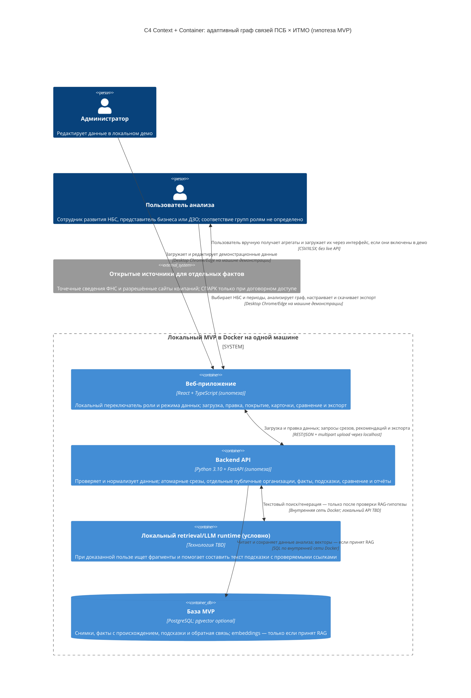

# C4 Architecture: адаптивный граф связей ПСБ × ИТМО

> **Версия:** 0.6 — синхронизация с API Inventory и анализом продуктовых связок  
> **Дата:** 2026-11-18  
> **Уровни:** C4 Context + Container  
> **Основание:** `artifacts/brief.md`, `artifacts/usm.md`, `artifacts/nfr.md`, `artifacts/schema.xlsx`, `artifacts/stakeholder.docx`, `../TeamPink/transcripts/псб-18-11/псб-18-11.md`

> **Рабочее уточнение 20.11.2026:** целевой результат — карточка «стоит рассмотреть» с фактами, источниками и пробелами для менеджера. Предиктивный NBO и формальная применимость из ранней постановки не входят в baseline. Их отличие от исходного ТЗ зафиксировано в брифе.

Обозначения в документе:

- **Факт** — зафиксирован в проектных материалах или решениях пользователя.
- **Гипотеза** — предлагаемое архитектурное решение для первой реализации; команда может его изменить.
- **Открыто** — параметр пока не выбран и не должен считаться согласованным.

## 1. Обзор системы

**Назначение — рабочая постановка.** MVP ограничен сценарием наполненности текущего клиентского портфеля выбранным НБС: просмотр покрытия, сбор фактов и подсказка менеджеру, продуктовые связки, сравнение периодов и экспорт. Иерархия владения компаниями в сценарий не входит.

**Аудитория и права.** Бизнес-группы пользователя — сотрудники развития НБС, бизнес и ДЗО. На встрече заказчик дополнительно назвал прикладные роли: администратор может редактировать данные, вторая роль использует анализ. Для локального MVP выбран переключатель роли в интерфейсе без входа; это не защита API. Матрица прав для банковского использования остаётся открытой.

**Профиль MVP — факт.** Семестровый демонстрационный прототип с загрузкой Excel/CSV, полностью синтетическими клиентскими данными и выбранным контекстом из открытого источника. Заказчик отказался передавать клиентские записи и принял, что синтетика показывает работу сценария и pipeline, но не качество рекомендаций на реальном портфеле. Реальные конфиденциальные банковские данные и подключение к банковским системам в текущую демонстрацию не включены. Отдельный вход в локальное демо не предусмотрен.

**Демонстрационные данные — решение команды после отказа заказчика предоставить данные.** Команда подготовит полностью синтетический набор по структуре из `schema.xlsx` минимум с двумя периодами. Он не копирует реальных клиентов. Для ДМС можно показать подсказку к рассмотрению на синтетическом кейсе с явными источниками и пробелами; это не подтверждает её качество в реальной работе.

**Объём данных — ориентир, не цель бенчмарка.** На встрече заказчик оценил клиентскую часть витрины примерно в 500 тысяч записей. Команда упомянула 100 тысяч синтетических наборов параметров, но размер эталонного набора не согласован. Архитектурная гипотеза: в браузер отдавать только выбранный фильтрами срез и агрегаты, а не весь клиентский портфель сразу.

**Архитектурное направление — гипотеза.** Веб-клиент, backend API и PostgreSQL запускаются на одной демонстрационной машине. Retrieval начинается с поиска по структурированным полям и доступному тексту. Локальный runtime для embeddings/генерации и pgvector добавляются лишь после проверки пользы на ограниченном корпусе; отдельная graph DB не предполагается.

**RAG — гипотеза для сборки оснований.** Доступный корпус пока ограничен каталогом/схемой, допустимым контекстом сайта клиента и СПАРК/Интерфакс при наличии доступа и разрешения. Векторизировать «все документы банка» нечего. Сначала проверить извлечение точных фрагментов и ссылок обычным поиском; embeddings/LLM добавлять только при измеримой пользе и проверке атрибуции. Генерация не создаёт факты и правила продукта.

**Классификатор — отдельный эксперимент.** LLM-разметка и обучение выполняются заранее на отдельном синтетическом корпусе, не в пользовательском запросе. При включении эксперимента Backend API загружает версионированный артефакт простой модели и показывает её кандидат отдельно от базовой карточки; отдельный runtime-контейнер для этого не требуется. На публичных реальных компаниях модельный кандидат не выводится. Происхождение фактов и решение менеджера остаются независимыми от классификатора.

**Решения локального MVP.** Публичные организации и их наблюдения — отдельная область хранения и API без ссылки на синтетических клиентов и банковские состояния. Веб-клиент явно переключает режим данных и демонстрационную роль; роль лишь управляет видимостью действий и не защищает API. Backend атомарно фиксирует проверенный файл как новый срез. Исправление сохранённого среза создаёт производный срез и сохраняет прежний для воспроизводимости.

**Демонстрационный НБС — решение пользователя.** Выбрано «Страхование → ДМС». В `schema.xlsx` есть этот подтип, но нет критериев применимости. Пересланный ориентир «сотрудники и команда → ДМС» помогает сформулировать вопрос менеджеру, но не является правилом пригодности. «Правокард» упомянут в брифе как пример, но отсутствует в перечне банковских продуктов из схемы.

## 2. Архитектурная диаграмма

Диаграмма намеренно не показывает соединение с Hadoop, банковскими витринами или банковской платформой: в материалах это возможное целевое окружение после MVP, а не интеграция семестрового прототипа.

## 3. Описание контейнеров

| Контейнер | Технология | Назначение | Масштабирование MVP |
|---|---|---|---|
| Веб-приложение | **Гипотеза:** React + TypeScript; библиотека графа не выбрана | Интерфейс администратора для импорта и правки данных; интерфейс анализа для фильтров, графа покрытия, карточки клиента, сравнения периодов, объяснения/отметки рекомендации, выбора экспортируемых полей и запуска экспорта | Один демонстрационный экземпляр в Docker; клиент рисует выбранный и отфильтрованный срез |
| Backend API | **Гипотеза:** Python 3.10 + FastAPI. Python 3.10 упоминается в ТЗ как среда будущего использования; FastAPI — предварительное решение | Приём и проверка Excel/CSV; сопоставление полей; версии и срезы; отдельное чтение публичных организаций; сравнение периодов; анализ связок; сбор фактов, подсказок и пробелов; обратная связь и отчёты. Серверной авторизации в локальном демо нет | Один экземпляр для демонстраций; объём набора и допустимая задержка TBD |
| Локальный retrieval/LLM runtime | **Условная гипотеза:** отдельный контейнер на той же машине | Поиск фрагментов и генерация текста только после проверки пользы RAG; каждый вывод проходит проверку привязки к источникам | Baseline может работать без этого контейнера; модель и ресурсы машины TBD |
| База MVP | **Гипотеза:** PostgreSQL в отдельном контейнере; pgvector — опционально | Хранение снимков, фактов с происхождением, карточек рассмотрения и обратной связи. Формальные критерии продуктов — только если они появятся; embeddings — после проверки RAG | Один экземпляр на машине демонстрации; размер мокового набора TBD. При выборе векторного поиска возможен pgvector ([документация проекта](https://github.com/pgvector/pgvector)) |

**Развёртывание — решение пользователя:** контейнеры запускаются на одной демонстрационной машине через Docker. **Гипотеза:** для совместного запуска использовать Docker Compose; host OS и доступность нужных ресурсов локальной модели ещё нужно проверить.

### Логические модули внутри Backend API

Это модули одного приложения, не отдельные C4-контейнеры:

- **Import & validation:** чтение Excel/CSV, проверка ИНН, пропусков и дублей, сопоставление колонок и идентификаторов; ошибки блокируют атомарную фиксацию, повторный commit одного preview возвращает тот же срез.
- **Graph & snapshots:** узлы, связи, выбранный период, получение подграфа и сравнение двух снимков.
- **Product associations & bundles:** просмотр совместной встречаемости продуктов по срезу и связок, описанных в исходных сведениях. Совместная встречаемость не подтверждает применимость или коммерческие условия; метрики обнаружения связок TBD.
- **Text retrieval:** baseline ищет по доступным полям и тексту с возвратом точного происхождения. Если проверка покажет пользу RAG, допустимые источники будут разбиваться на фрагменты и индексироваться локально; объём корпуса и форматы документов ещё не решены.
- **Evidence-backed consideration:** наблюдаемое состояние продукта, факты и источники, предостережения, пробелы и текст «стоит рассмотреть». Автоматический вывод о применимости и вероятность покупки не формируются.
- **Synthetic classifier experiment (условно):** offline разметка и обучение создают версионированный артефакт модели; при включении модуль inference возвращает отдельный кандидат только для синтетического среза. Это не источник фактов и не замена логики карточки.
- **Feedback:** сохранение статуса «принята / отложена / нерелевантна» и причины; автоматическое переобучение на отметках не предполагается.
- **Export:** **гипотеза границ:** веб-клиент экспортирует текущее представление графа, чтобы сохранить выбранный масштаб, позицию и подсветку; backend формирует аналитический отчёт PDF/PPTX по выбранным данным и фильтрам. Поддержку каждого формата графа нужно проверить с выбранной библиотекой визуализации.

## 4. Внешние системы и источники

| Система/источник | Назначение | Интеграция в MVP | Fallback |
|---|---|---|---|
| Синтетический Excel/CSV команды | Тестовые записи действующих клиентов и продуктов для одного сценария наполненности НБС | Команда генерирует файл по `schema.xlsx`, минимум с двумя периодами. Реальные имена, ИНН и клиентские записи не используются. Объём набора не выбран | Повторная генерация из фиксированной схемы/seed или заранее подготовленный fixture |
| Документы компании с текстовым содержимым | Возможные источники сведений о клиенте, конкурентах и условиях | Документы как источники данных — гипотеза пользователя. RAG и чтение PDF/других форматов не утверждены; подтверждённый файловый сценарий MVP пока ограничен XLSX/CSV | Если RAG не войдёт в MVP, анализировать доступные структурированные поля и заметки обычной логикой |
| ФНС и разрешённые сайты компаний | Точечные факты об отдельных реальных организациях | Открытый контекст готовится отдельно от синтетического портфеля, без live API | Сохранить точный URL, дату и текст; не соединять с вымышленными клиентами |
| Hadoop, банковские витрины, банковская платформа | Возможные внутренние источники и целевое окружение из ТЗ | Не подключаются в текущем MVP; реальные банковские данные не используются | Подготовленные/синтетические данные |

## 5. Потоки данных

### Основной поток

1. Администратор загружает Excel/CSV через веб-интерфейс.
2. Backend проверяет структуру и идентификаторы, нормализует данные и возвращает результат импорта с ошибками и неоднозначными сопоставлениями.
3. Проверенный синтетический набор атомарно сохраняется как снимок с датой и источником «синтетические данные»; исправление создаёт новый снимок с ссылкой на предыдущий.
4. Пользователь анализа выбирает НБС, период и фильтры; backend возвращает срез покрытия и агрегаты, затем собирает относящиеся к клиенту факты из разрешённых источников.
5. Карточка показывает источник и дату каждого факта, «стоит рассмотреть» как интерпретацию и отдельные пробелы/предостережения. При ненадёжной привязке источника к клиенту система воздерживается от персонального вывода. Решение и причина менеджера сохраняются отдельно.
6. Пользователь сравнивает два снимка, выбирает поля для экспорта и получает файл, соответствующий текущему экранному представлению, а также аналитический отчёт.

### Поток открытых данных

Открытый контекст готовится как отдельный набор фактов о выбранных реальных организациях из точечных сведений ФНС и разрешённых страниц компаний, без live API. Происхождение, дата и текст фрагмента фиксируются в отдельных `public_organizations` и `public_evidence_items` со ссылками на общие наблюдения источников. Факты никогда не приписываются синтетическим клиентам. СПАРК без договорного доступа не используется.

### Обработка и хранение файлов

**Гипотеза:** исходный загруженный файл временно обрабатывается backend; нормализованные данные и метаданные снимков сохраняются в Docker volume до ручной очистки после демонстрации. Срок хранения исходного файла нужно решить перед реализацией импорта. Экспортируемые файлы возвращаются пользователю по запросу и постоянно не хранятся.

## 6. Ключевые решения-гипотезы

| Решение | Гипотеза | Почему | Альтернатива / условие пересмотра |
|---|---|---|---|
| Число развёртываемых компонентов | Веб-клиент, backend и база; локальный retrieval/LLM runtime условен | Семестровый прототип с ограниченным корпусом | Добавлять отдельный runtime после проверки RAG и ресурсов машины |
| Обмен UI и backend | REST/JSON; загрузка файла multipart; ответы с экспортом как download | Достаточно для фильтров, загрузки, сравнения и экспорта; real-time сценарий не задан | WebSocket/очередь только при появлении live-обновлений или долгих расчётов |
| Backend | Python 3.10 + FastAPI | Python 3.10 указан в ТЗ для целевого окружения; FastAPI — лёгкая гипотеза для API MVP | Другой Python web framework, если команда уже имеет заготовку или опыт, снижающий срок разработки |
| Запуск | Docker на одной демонстрационной машине — решение пользователя; Docker Compose — гипотеза | Контейнеризация фиксирует способ запуска web, API и DB | При включении retrieval/LLM проверить ресурсы машины |
| База | PostgreSQL; pgvector — только при подтверждении RAG | PostgreSQL покрывает структурированные объекты, связи, снимки, критерии и обратную связь. pgvector добавляет хранение/поиск embeddings в той же БД ([документация проекта](https://github.com/pgvector/pgvector)) | Если размер/нагрузка потребуют, отдельно сравнить векторное хранилище; пока отдельный сервис не добавляется |
| RAG | Открытая гипотеза пользователя; не включена в обязательный сценарий до проверки | Документы могут стать источниками данных; RAG — один из способов искать фрагменты, но необходимость, корпус и поддерживаемые форматы пока не определены | Проверить ценность на ограниченном наборе после определения документа и задачи пользователя |
| AI runtime | Условный локальный компонент для retrieval/генерации | В baseline достаточно воспроизводимого поиска по разрешённым источникам; RAG проверяется на контрольных вопросах и цитатах | Добавить модель лишь если она помогает находить нужные фрагменты и не ухудшает привязку фактов |
| Экспорт | Веб-клиент формирует файлы текущего графа; backend формирует аналитические PDF/PPTX отчёты | Заказчик просит выбирать поля перед экспортом и сохранять вид, который пользователь просматривает | Проверить форматы графа и воспроизведение выбранного состояния после выбора библиотеки визуализации; размер страницы A4 не фиксировать из-за неясной расшифровки |
| Хранение демо-данных | Нормализованные снимки и обратная связь сохраняются в Docker volume до ручной очистки после демонстрации; исходные загрузки и экспорты временные | История нужна для сравнения периодов и обратной связи; демо использует синтетические данные | Сроки хранения и очистки подтвердить до загрузки любых реальных или банковских данных |
| Открытые источники | Точечные сведения ФНС и разрешённые страницы компаний в отдельном режиме | Банковские связи синтетические, а публичные факты о реальных компаниях нельзя прикреплять к вымышленным клиентам | Подготовленный файл без live API; конкретные компании, URL и условия страниц проверить перед включением. СПАРК без договорного доступа исключён |
| Каталог НБС и автообновление витрины | **Факт:** перечень продуктов неполный и должен дополняться; заказчик ожидает его обновление при изменении витрины | Команда не получила доступ к витрине; механизм и принадлежность интеграции к MVP не определены | В первой демонстрации администратор может дополнить каталог вручную; интеграцию обновления проектировать после уточнения системы-источника и частоты |
| Роли и доступ | Администратор редактирует данные; пользователь анализа просматривает результаты | Локальный переключатель роли управляет видимостью действий, но API не защищает | Для использования внутри Банка отдельно согласовать аутентификацию и матрицу доступа с ИБ |
| Размер и обработка набора | Около 500 тыс. записей — устная оценка заказчика по витрине, не целевой объём MVP | Предложенные командой 100 тыс. синтетических наборов не утверждены | Зафиксировать объём синтетики и целевые времена; отдавать в UI фильтрованные срезы и агрегаты |
| Подсказки менеджеру | Backend собирает проверяемые факты и пробелы и формирует карточку «стоит рассмотреть» | Формальной матрицы продуктов нет; основная боль — время на сбор разрозненной информации | Проверить источник каждого факта и пройти контрольные кейсы с менеджером; время экономии пока не измерено |
| Безопасность демо | Данные в демо синтетические, для локального MVP отдельный вход не предусмотрен; две прикладные роли названы заказчиком | Переключатель роли не обеспечивает ограничение прямых API-запросов | Перед использованием данных Банка — отдельное решение по периметру, аутентификации, ролям и ИБ |

## 7. Нерешённые вопросы

- [ ] Составить контрольные кейсы ДМС: есть подтверждённые сведения о сотрудниках; сведения противоречат; источник не удаётся привязать к клиенту. Проверить формулировку подсказки и воздержание от вывода.
- [ ] При решении включить RAG проверить ресурсы демонстрационной машины и качество поиска на ограниченном корпусе.
- [ ] Сгенерировать демонстрационный набор по `schema.xlsx` минимум с двумя периодами и зафиксировать количество строк, клиентов, узлов и связей. Отдельного эталонного датасета в `artifacts` нет.
- [ ] Сравнить поиск по полям/тексту и RAG на одном наборе вопросов; определить разрешённый корпус, источники, формат ссылок и критерий правильной атрибуции.
- [ ] Выбрать библиотеку визуализации и проверить экспорт PNG/SVG/PDF/PPTX на эталонном наборе.
- [ ] Уточнить, входит ли в MVP автоматическое дополнение каталога НБС при изменении банковской витрины и какой доступ к ней возможен.
- [ ] Выбрать конкретные организации и URL из ФНС и разрешённых сайтов компаний; сохранить даты, фрагменты и условия использования каждой страницы.
- [ ] Уточнить права администратора и пользователя анализа и способ демонстрации их различий без отдельного входа; аутентификацию отдельно согласовать для будущего использования внутри Банка.
- [ ] До использования реальных или банковских данных согласовать сроки хранения и удаления загрузок, снимков и обратной связи.

## 8. Границы этой версии

Это гипотеза C4 уровня Context + Container, а не утверждённый production design. Семейства открытых источников и границы их использования выбраны в [MVP baseline](./mvp-baseline.md); конкретные организации и URL ещё не зафиксированы. Форматы RAG, ресурсы условного локального runtime и требования промышленной эксплуатации остаются открытыми.
