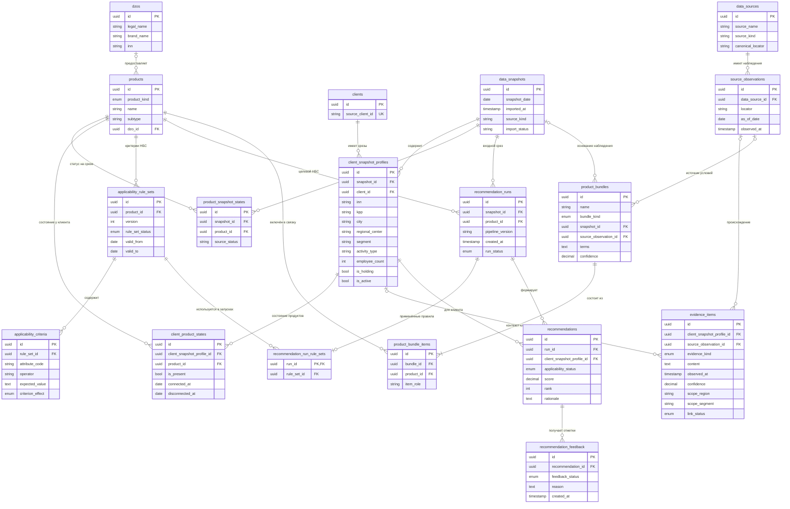

# Data Model: анализ наполненности НБС — ПСБ × ИТМО

> **Версия:** 0.3 — нормализованный черновик после проверки зависимостей и синхронизации сессии/ролей  
> **Дата:** 2026-11-18  
> **Статус:** черновик для обсуждения; перед миграциями нужно закрыть открытые вопросы ниже.  
> **Основано на:** `artifacts/brief.md` (консолидирован после встречи 18.11.2026), `artifacts/usm.md` (итерация 1), `artifacts/nfr.md`, `artifacts/c4-architecture.md` (версия 0.6), `artifacts/schema.xlsx`.

Обозначения в документе:

- **Факт** — поле, поведение или ограничение присутствует в проектных материалах.
- **Гипотеза** — предложено для первой реляционной модели, но не согласовано как требование.
- **Открытый вопрос** — данных пока недостаточно, чтобы закрепить ограничение или окончательную структуру.

## 1. Обзор

**Всего сущностей:** 18.  
**Тип БД:** PostgreSQL — гипотеза C4 для локального прототипа в Docker. Отдельная graph DB не предполагается. `pgvector` и таблицы для embeddings не входят в базовую модель: RAG остаётся гипотезой.

Модель хранит каталог НБС и банковских продуктов, клиентов и их атрибуты на дату среза, состояния продуктов, сведения с происхождением, правила применимости, результаты демонстрационного pipeline, обратную связь и продуктовые связки. Граф — представление этих записей, а не отдельная копия данных.

### Группы

- **Core:** `clients`, `data_snapshots`, `client_snapshot_profiles`.
- **Reference:** `dzos`, `products`, `data_sources`.
- **Business:** `source_observations`, `product_snapshot_states`, `client_product_states`, `evidence_items`, `applicability_rule_sets`, `applicability_criteria`, `recommendation_runs`, `recommendation_run_rule_sets`, `recommendations`, `recommendation_feedback`, `product_bundles`.
- **Junction:** `product_bundle_items`.

**Границы модели:** одна компания-клиент — самостоятельная запись; корпоративная иерархия и связи владения не моделируются. Флаг холдинга из исходной схемы остаётся атрибутом состояния клиента, а не основанием строить граф владения. В БД предполагаются синтетические демонстрационные записи. Открытый контекст не связывается с синтетическим клиентом без подтверждённого соответствия.

Не предлагается сохранять экспортированные файлы и временные ошибки импорта: требования к их хранению не заданы, а экспорт может формироваться по запросу. Отдельные таблицы пользователей/ролей не включены: для локального демо ранее подтверждено отсутствие отдельного входа, а способ демонстрации разных прав не выбран. Связь отметок обратной связи с конкретным пользователем также не фиксируется.

### Проверка нормальных форм

**Предварительный результат: структура приведена к кандидату на 3НФ при перечисленных ключах и смысловых правилах; формально подтвердить 3НФ до согласования функциональных зависимостей источника нельзя.** В этой итерации устранены выявленные дубли: статус продукта перенесён на уровень `срез × продукт`, наблюдение источника отделено от справочника источников, а применённый набор правил отделён от целевого НБС запуска.

- Поля заданы как скалярные значения. `expected_value` — одно значение критерия; списки и диапазоны нельзя упаковывать в одно поле.
- Для таблиц с составным естественным ключом указаны предлагаемые `UNIQUE`, чтобы атрибуты зависели от всей пары ключей, а не от её части.
- Внутри каждой сущности не оставлено атрибутов, которые по текущей модели выводятся из другого неключевого атрибута той же таблицы.
- Значения на дату хранятся в срезах; стабильные каталоги и конкретные версии источников разделены.

Ключевые зависимости в этой версии:

- `clients.id` ↔ `clients.source_client_id` (оба ключа уникальны).
- `(client_snapshot_profiles.snapshot_id, client_snapshot_profiles.client_id)` → ИНН, КПП и атрибуты клиента на дату.
- `(product_snapshot_states.snapshot_id, product_snapshot_states.product_id)` → статус продукта в каталоге на дату.
- `(client_product_states.client_snapshot_profile_id, client_product_states.product_id)` → наличие и даты подключения/отключения у клиента.
- `recommendation_runs.id` → один срез и один целевой НБС; применённый набор правил хранится в отдельной таблице-связи.
- `(recommendations.run_id, recommendations.client_snapshot_profile_id)` → результат pipeline по клиенту в этом запуске.
- `(product_bundle_items.bundle_id, product_bundle_items.product_id)` → роль продукта в связке.

Пользователь подтвердил основной ключ Client ID. Формальная проверка физической схемы всё ещё потребует проверить уникальность на тестовых данных и подтвердить семантику продуктовых статусов и дат; сейчас это логическая проверка модели без DDL и клиентских строк.

## 2. ER-диаграмма

## 3. Описание сущностей

Типы и ограничения ниже — предлагаемый PostgreSQL-слой, а не утверждённая физическая схема. UUID используется как технический ключ; бизнес-ключи и правила проверки пока не закреплены. `Default` не задан там, где источник не определяет поведение.

### `dzos`

**Назначение:** справочник юридических лиц и брендов ДЗО, связанных с НБС. Не задаёт корпоративную иерархию клиентов.

| Поле | Тип | Null | Default | Индекс / ограничение | Описание |
|---|---|---:|---|---|---|
| `id` | UUID | NO | — | PK | Технический идентификатор. |
| `legal_name` | TEXT | YES | — | — | Юридическое лицо ДЗО из схемы. |
| `brand_name` | TEXT | YES | — | — | Бренд ДЗО. |
| `inn` | VARCHAR | YES | — | — | ИНН ДЗО как строка; длина и уникальность не закреплены. |

**Бизнес-правила:** связь продукта с ДЗО опциональна. Гипотеза первой версии — у записи продукта не более одного ДЗО; необходимость нескольких поставщиков для одного НБС не подтверждена.

### `products`

**Назначение:** единый справочник НБС и банковских продуктов для покрытия клиента и продуктовых связок.

| Поле | Тип | Null | Default | Индекс / ограничение | Описание |
|---|---|---:|---|---|---|
| `id` | UUID | NO | — | PK | Технический идентификатор продукта. |
| `product_kind` | ENUM | NO | — | `nbs`, `bank` | Различает НБС и банковские продукты. |
| `name` | TEXT | NO | — | — | Наименование продукта. |
| `subtype` | TEXT | YES | — | — | Подтип НБС, например «ДМС»; для банковского продукта может быть пустым. |
| `dzo_id` | UUID | YES | — | FK → `dzos.id` | ДЗО-поставщик, если применимо. |

**Бизнес-правила:** в `schema.xlsx` перечислены оба вида продуктов. Дедупликация названий, код продукта, состояние каталога и исторические изменения каталога не определены. Для применимости правил допустимы только продукты `product_kind = 'nbs'`.

### `clients`

**Назначение:** каноническая внутренняя идентичность клиента, связывающая его профили в разных срезах.

| Поле | Тип | Null | Default | Индекс / ограничение | Описание |
|---|---|---:|---|---|---|
| `id` | UUID | NO | — | PK | Технический идентификатор клиента. |
| `source_client_id` | VARCHAR | NO | — | UK | Основной идентификатор клиента из источника; хранить строкой. |

**Бизнес-правила:** `source_client_id` — подтверждённый пользователем основной ключ сопоставления клиента между срезами и уникален в наборе банковских клиентов. Канонический `id` создаётся только для однозначно сопоставленного клиента; ИНН/КПП используются для проверки записи, но не для уникальности или выбора клиента.

### `data_snapshots`

**Назначение:** импортированный набор данных на дату, используемый для анализа и сравнения периодов.

| Поле | Тип | Null | Default | Индекс / ограничение | Описание |
|---|---|---:|---|---|---|
| `id` | UUID | NO | — | PK | Идентификатор среза. |
| `snapshot_date` | DATE | NO | — | — | Дата данных из файла. Семантика колонки `дата` требует подтверждения. |
| `imported_at` | TIMESTAMPTZ | NO | CURRENT_TIMESTAMP* | — | Время загрузки в приложение, отдельно от даты состояния. |
| `source_kind` | TEXT | NO | — | — | Например, синтетический XLSX/CSV; перечень значений уточнить. |
| `original_filename` | TEXT | YES | — | — | Имя файла для происхождения; хранение самого файла не подразумевается. |
| `import_status` | ENUM | NO | — | `loaded`, `rejected`, `partial` — гипотеза | Сводный результат проверки импорта. |

\* Предлагаемый default, требует подтверждения. Повторная загрузка той же даты может создавать новый срез; правило идентичности и замены пока не определено.

### `client_snapshot_profiles`

**Назначение:** изменяемые во времени характеристики клиента. Сущность отделена от `clients`, чтобы сравнение срезов не затирало старые значения.

| Поле | Тип | Null | Default | Индекс / ограничение | Описание |
|---|---|---:|---|---|---|
| `id` | UUID | NO | — | PK | Идентификатор профиля в срезе. |
| `snapshot_id` | UUID | NO | — | FK → `data_snapshots.id` | Срез данных. |
| `client_id` | UUID | NO | — | FK → `clients.id` | Устойчивая идентичность клиента. |
| `inn` | VARCHAR | YES | — | — | ИНН как строка, чтобы не терять формат и ведущие нули. |
| `kpp` | VARCHAR | YES | — | — | КПП, если он есть в источнике; в `schema.xlsx` отдельной колонки нет. |
| `name` | TEXT | YES | — | — | Название клиента на дату среза. |
| `city` | TEXT | YES | — | — | Город клиента. |
| `regional_center` | TEXT | YES | — | — | Региональный центр из исходной схемы. |
| `segment` | TEXT | YES | — | — | Сегмент клиента. |
| `activity_type` | TEXT | YES | — | — | Вид деятельности; пример критерия из ТЗ, колонки в `schema.xlsx` нет. Добавлять в набор только при необходимости для подтверждённых правил. |
| `employee_count` | INT | YES | — | — | Численность сотрудников; пример критерия из ТЗ, колонки в `schema.xlsx` нет. Добавлять в набор только при необходимости для подтверждённых правил. |
| `is_holding` | BOOLEAN | YES | — | — | Флаг исходных данных; не создаёт связь владения. |
| `is_active` | BOOLEAN | YES | — | — | Активность клиента на дату среза. |

**Бизнес-правила:** предложенное ограничение `UNIQUE(snapshot_id, client_id)` — одна строка профиля клиента на срез. ИНН/КПП фиксируются на дату для проверки и сохранения исходного значения; расхождение с предыдущим срезом не создаёт нового клиента автоматически. Справочники регионов и сегментов не создаются до появления согласованных кодов/таксономии. `activity_type` и `employee_count` включены как nullable-кандидаты из примеров критериев в ТЗ, а не как подтверждённые поля демофайла.

### `product_snapshot_states`

**Назначение:** статус продукта в каталоге на дату среза. Отделяет актуальность самого продукта от факта его наличия у конкретного клиента.

| Поле | Тип | Null | Default | Индекс / ограничение | Описание |
|---|---|---:|---|---|---|
| `id` | UUID | NO | — | PK | Идентификатор состояния продукта. |
| `snapshot_id` | UUID | NO | — | FK → `data_snapshots.id` | Срез, на дату которого известен статус каталога. |
| `product_id` | UUID | NO | — | FK → `products.id` | Продукт. |
| `source_status` | TEXT | YES | — | — | Статус НБС/банковского продукта из источника на указанную дату. |

**Бизнес-правила:** предлагается `UNIQUE(snapshot_id, product_id)`: одно значение статуса каталога продукта на срез. Интерпретация следует описанию колонок `статус НБС` и `статус продукта банка` в `schema.xlsx` («актуальность на конкретную дату»); её нужно сверить с заказчиком. Не смешивать это поле с наличием продукта у клиента.

### `client_product_states`

**Назначение:** наличие и даты подключения/отключения продукта у клиента на конкретном срезе. Используется как для НБС, так и для банковских продуктов.

| Поле | Тип | Null | Default | Индекс / ограничение | Описание |
|---|---|---:|---|---|---|
| `id` | UUID | NO | — | PK | Идентификатор состояния. |
| `client_snapshot_profile_id` | UUID | NO | — | FK → `client_snapshot_profiles.id` | Клиент и дата среза. |
| `product_id` | UUID | NO | — | FK → `products.id` | Продукт, наличие которого описывается. |
| `is_present` | BOOLEAN | YES | — | — | Флаг наличия на дату. `NULL` означает неизвестность, не «нет». |
| `connected_at` | DATE | YES | — | — | Дата подключения. |
| `disconnected_at` | DATE | YES | — | — | Дата отключения. |

**Бизнес-правила:** предложенное `UNIQUE(client_snapshot_profile_id, product_id)` — одно состояние пары клиент–продукт на срез. Отсутствие строки нельзя автоматически трактовать как отсутствие продукта, пока не подтверждены полнота выгрузки и семантика флага. `is_present` и даты подключения/отключения описывают состояние у клиента; статус каталога хранится отдельно в `product_snapshot_states`.

### `data_sources`

**Назначение:** стабильная запись об источнике сведений, отдельно от конкретной даты/версии его получения.

| Поле | Тип | Null | Default | Индекс / ограничение | Описание |
|---|---|---:|---|---|---|
| `id` | UUID | NO | — | PK | Идентификатор источника. |
| `source_name` | TEXT | NO | — | — | Название источника; конкретный открытый источник ещё не выбран. |
| `source_kind` | TEXT | NO | — | — | Например, файл, открытый сайт или ручная заметка; справочник значений не утверждён. |
| `canonical_locator` | TEXT | YES | — | — | Постоянный URL или базовый идентификатор источника, если есть. |
| `usage_note` | TEXT | YES | — | — | Ограничения использования/пояснение происхождения, если известны. |

**Бизнес-правила:** запись источника не означает, что интеграция или право использования уже согласованы.

### `source_observations`

**Назначение:** конкретное получение/выгрузка сведений из источника на определённую дату. Разделение предотвращает перезапись даты актуальности при повторном получении одного источника.

| Поле | Тип | Null | Default | Индекс / ограничение | Описание |
|---|---|---:|---|---|---|
| `id` | UUID | NO | — | PK | Идентификатор наблюдения/выгрузки. |
| `data_source_id` | UUID | NO | — | FK → `data_sources.id` | Стабильный источник. |
| `locator` | TEXT | YES | — | — | URL, путь или идентификатор именно этой выгрузки. |
| `as_of_date` | DATE | YES | — | — | Дата актуальности сведений в этой версии источника. |
| `observed_at` | TIMESTAMPTZ | YES | — | — | Когда команда получила/зафиксировала эту версию. |
| `observation_note` | TEXT | YES | — | — | Пояснение к конкретной выгрузке, если нужно. |

**Бизнес-правила:** один `data_source` может иметь несколько наблюдений/версий. Срок хранения и сохранение самого файла/документа не определены.

### `evidence_items`

**Назначение:** заметки, сведения о конкурентах, условиях и отдельный открытый контекст с сохранением происхождения.

| Поле | Тип | Null | Default | Индекс / ограничение | Описание |
|---|---|---:|---|---|---|
| `id` | UUID | NO | — | PK | Идентификатор сведения. |
| `client_snapshot_profile_id` | UUID | YES | — | FK → `client_snapshot_profiles.id` | Ссылка на клиента только при подтверждённом сопоставлении. |
| `source_observation_id` | UUID | YES | — | FK → `source_observations.id` | Конкретная версия источника, если она известна. |
| `evidence_kind` | ENUM | NO | — | `employee_note`, `competitor_info`, `competitor_terms`, `open_context` — гипотеза | Вид текстового/контекстного сведения. |
| `content` | TEXT | NO | — | — | Текст заметки или описания; не является embedding. |
| `observed_at` | TIMESTAMPTZ | YES | — | — | Когда было зафиксировано само сведение; отдельно от даты выгрузки источника. |
| `confidence` | NUMERIC | YES | — | — | Степень уверенности источника/связи, если доступна; шкала не задана. |
| `scope_region` | TEXT | YES | — | — | Регион агрегатного контекста, если источник его задаёт; не является связью с компанией. |
| `scope_segment` | TEXT | YES | — | — | Сегмент агрегатного контекста, если применимо. |
| `link_status` | ENUM | NO | — | `matched`, `unmatched`, `aggregate` — гипотеза | Подтверждает, можно ли связать сведения с клиентом или только с агрегатным контекстом. |

**Бизнес-правила:** `matched` допускается только при непустой ссылке на профиль клиента. Агрегатные и несопоставленные сведения не связываются с синтетическими компаниями. Наличие этой сущности не означает, что RAG входит в MVP.

### `applicability_rule_sets`

**Назначение:** версия набора критериев применимости для НБС.

| Поле | Тип | Null | Default | Индекс / ограничение | Описание |
|---|---|---:|---|---|---|
| `id` | UUID | NO | — | PK | Идентификатор набора правил. |
| `product_id` | UUID | NO | — | FK → `products.id` | Целевой НБС. |
| `version` | INT | NO | — | UK совместно с `product_id` — предложение | Версия набора критериев. |
| `rule_set_status` | ENUM | NO | — | `draft`, `active`, `retired` — гипотеза | Состояние набора. |
| `valid_from` | DATE | YES | — | — | Начало действия, если применимо. |
| `valid_to` | DATE | YES | — | — | Конец действия, если применимо. |
| `source_note` | TEXT | YES | — | — | Основание/источник правил. |

**Бизнес-правила:** правило нельзя считать согласованным только потому, что оно сохранено в БД. Для ДМС критерии заказчиком ещё не предоставлены; при отсутствии активного набора положительная применимость не выставляется, результат — «данных недостаточно».

### `applicability_criteria`

**Назначение:** атомарные условия внутри версии набора критериев.

| Поле | Тип | Null | Default | Индекс / ограничение | Описание |
|---|---|---:|---|---|---|
| `id` | UUID | NO | — | PK | Идентификатор условия. |
| `rule_set_id` | UUID | NO | — | FK → `applicability_rule_sets.id` | Набор правил. |
| `attribute_code` | VARCHAR | NO | — | — | Проверяемый атрибут клиента/продукта; перечень не задан. |
| `operator` | VARCHAR | NO | — | — | Оператор сравнения, например равенство или диапазон; каталог операторов не задан. |
| `expected_value` | TEXT | NO | — | — | Значение/граница критерия. Типизация будет зависеть от критериев ДМС. |
| `criterion_effect` | ENUM | NO | — | `include`, `exclude` — предложение | Условие применимости или исключения. |

**Открытая часть:** правила объединения условий (AND/OR), диапазоны, типизация значений и приоритет исключений не определены. До получения критериев не закреплять их как окончательную логику.

### `recommendation_runs`

**Назначение:** запуск демонстрационного pipeline для выбранного НБС и среза, чтобы связать результаты с входными данными и версией логики.

| Поле | Тип | Null | Default | Индекс / ограничение | Описание |
|---|---|---:|---|---|---|
| `id` | UUID | NO | — | PK | Идентификатор запуска. |
| `snapshot_id` | UUID | NO | — | FK → `data_snapshots.id` | Входной срез данных. |
| `product_id` | UUID | NO | — | FK → `products.id` | Выбранный НБС. |
| `pipeline_version` | VARCHAR | YES | — | — | Версия кода/конфигурации pipeline, если команда решит её фиксировать. |
| `created_at` | TIMESTAMPTZ | NO | CURRENT_TIMESTAMP* | — | Время запуска. |
| `run_status` | ENUM | NO | — | `started`, `completed`, `failed` — гипотеза | Технический результат запуска. |

**Бизнес-правила:** продукт запуска должен быть НБС. Использованный набор критериев хранится в отдельной связи `recommendation_run_rule_sets`, а не дублируется здесь. Синтетический pipeline демонстрирует поток скоринга/ранжирования; качество NBO на нём не заявляется.

### `recommendation_run_rule_sets`

**Назначение:** фиксирует, какой набор критериев был применён в конкретном запуске. Отдельная связь не дублирует в запуске продукт, который уже функционально определяется набором правил.

| Поле | Тип | Null | Default | Индекс / ограничение | Описание |
|---|---|---:|---|---|---|
| `run_id` | UUID | NO | — | PK, FK → `recommendation_runs.id` | Запуск; PK означает не более одного набора правил на запуск в этой версии модели. |
| `rule_set_id` | UUID | NO | — | FK → `applicability_rule_sets.id` | Набор правил, использованный при запуске. |

**Бизнес-правила:** запись отсутствует, если применимого набора правил нет; в этом случае система не выставляет положительную применимость. Набор правил должен относиться к тому же НБС, что и запуск; соответствие контролируется составным FK или логикой приложения.

### `recommendations`

**Назначение:** результат применимости и демонстрационного ранжирования для клиента на конкретном запуске.

| Поле | Тип | Null | Default | Индекс / ограничение | Описание |
|---|---|---:|---|---|---|
| `id` | UUID | NO | — | PK | Идентификатор рекомендации. |
| `run_id` | UUID | NO | — | FK → `recommendation_runs.id` | Запуск, создавший результат. |
| `client_snapshot_profile_id` | UUID | NO | — | FK → `client_snapshot_profiles.id` | Клиент в анализируемом срезе. |
| `applicability_status` | ENUM | NO | — | `eligible`, `ineligible`, `insufficient_data`, `excluded` — проектное предложение | Результат проверки условий, не коммерческое решение. |
| `score` | NUMERIC | YES | — | — | Значение pipeline; смысл, диапазон и калибровка не определены. |
| `rank` | INT | YES | — | — | Позиция в порядке рассмотрения, если она рассчитана. |
| `rationale` | TEXT | YES | — | — | Объяснение, критерии и доступные основания вывода. |
| `exclusion_reason` | TEXT | YES | — | — | Причина исключения, если применимо. |

**Бизнес-правила:** профиль клиента должен относиться к тому же срезу, что и `recommendation_runs.snapshot_id`; проверять это составным ограничением или логикой приложения. Отсутствие записи о клиенте не считается рекомендацией. Предложенное `UNIQUE(run_id, client_snapshot_profile_id)` предполагает один итог на клиента в одном запуске; при нескольких кандидатах/продуктах ограничение нужно изменить. Отметка `eligible` запрещена без согласованных критериев и достаточных исходных данных.

### `recommendation_feedback`

**Назначение:** пользовательская отметка к рекомендации; обратная связь не переобучает pipeline автоматически.

| Поле | Тип | Null | Default | Индекс / ограничение | Описание |
|---|---|---:|---|---|---|
| `id` | UUID | NO | — | PK | Идентификатор отметки. |
| `recommendation_id` | UUID | NO | — | FK → `recommendations.id` | Рекомендация, к которой относится отметка. |
| `feedback_status` | ENUM | NO | — | `accepted`, `deferred`, `irrelevant` | Согласованные значения статуса. |
| `reason` | TEXT | NO | — | — | Причина отметки. |
| `created_at` | TIMESTAMPTZ | NO | CURRENT_TIMESTAMP* | — | Время отметки. |

**Бизнес-правила:** допускается хранение нескольких отметок на одну рекомендацию как истории изменений — это гипотеза. ID пользователя не включён, пока не решены вход, роли и аудит.

### `product_bundles`

**Назначение:** наблюдаемая продуктовая связка или описанное пакетное предложение.

| Поле | Тип | Null | Default | Индекс / ограничение | Описание |
|---|---|---:|---|---|---|
| `id` | UUID | NO | — | PK | Идентификатор связки/предложения. |
| `name` | TEXT | YES | — | — | Краткое название. |
| `bundle_kind` | ENUM | NO | — | `observed_association`, `offer` — гипотеза | Совместная встречаемость в данных либо предложение/бандл. |
| `snapshot_id` | UUID | YES | — | FK → `data_snapshots.id` | Срез, на котором обнаружена связь. |
| `source_observation_id` | UUID | YES | — | FK → `source_observations.id` | Конкретный источник условий или сведений. |
| `terms` | TEXT | YES | — | — | Условия и скидки, если источник их содержит. |
| `confidence` | NUMERIC | YES | — | — | Оценка основания связки; шкала/расчёт не заданы. |

**Бизнес-правила:** связь между продуктами не равна подтверждённому предложению. Условия нельзя выдумывать при отсутствии источника. Минимальное число элементов — два (предлагаемое ограничение).

### `product_bundle_items`

**Назначение:** связывает продукты, входящие в наблюдаемую связку или бандл.

| Поле | Тип | Null | Default | Индекс / ограничение | Описание |
|---|---|---:|---|---|---|
| `id` | UUID | NO | — | PK | Технический идентификатор элемента. |
| `bundle_id` | UUID | NO | — | FK → `product_bundles.id` | Связка/предложение. |
| `product_id` | UUID | NO | — | FK → `products.id` | Входящий продукт. |
| `item_role` | VARCHAR | YES | — | — | Роль продукта в бандле, если есть (основной, дополнительный и т. п.). |

**Бизнес-правила:** предлагаемое `UNIQUE(bundle_id, product_id)` исключает повтор одного продукта в одной связке. Справочник ролей продукта в бандле не согласован.

### Общие ограничения модели

- `clients.source_client_id` — уникальный бизнес-ключ, подтверждённый пользователем. ИНН/КПП хранятся строками в `client_snapshot_profiles` как значения для проверки на дату, а не как ключи.
- Предлагаемые альтернативные ключи: `client_snapshot_profiles(snapshot_id, client_id)`; `product_snapshot_states(snapshot_id, product_id)`; `client_product_states(client_snapshot_profile_id, product_id)`; `applicability_rule_sets(product_id, version)`; `recommendations(run_id, client_snapshot_profile_id)`; `product_bundle_items(bundle_id, product_id)`. Их нужно закрепить ограничениями `UNIQUE` до миграций.
- Уникальность ИНН/КПП не задаётся; эти значения используются для проверки и могут изменяться между срезами.
- Ссылки должны проверять совпадение срезов: `client_product_states` и `product_snapshot_states` относятся к тому же `data_snapshot`, что профиль клиента; профиль рекомендации относится к срезу запуска. При необходимости закрепить это составными внешними ключами.
- Продукт в запуске и применённый набор правил должны относиться к одному НБС; ограничения по типу `products.product_kind = 'nbs'` также требуют проверки.
- Числовой `score` хранится только как демонстрационный результат; метрика качества и шкала не заданы.
- Нет таблиц пользователей, сессий и ролей, embeddings, договоров/оплат, а также экспорта: эти сущности вне принятой границы MVP или пока не подтверждены.

## 4. Связи

Кардинальности показаны на диаграмме. Для всех физических внешних ключей ниже приведена предлагаемая политика удаления; политика хранения/удаления данных в NFR ещё открыта, поэтому до утверждения безопаснее запрещать удаление используемых родительских записей.

| Связь | Тип | Описание | Каскад |
|---|---|---|---|
| `dzos` → `products` | 1:N, FK `products.dzo_id` nullable | Одно ДЗО может быть связано с несколькими продуктами; продукт может быть без ДЗО. | `RESTRICT` — предложение. |
| `clients` → `client_snapshot_profiles` | 1:N, профиль принадлежит одному клиенту | Идентичность клиента сохраняется между срезами. | `RESTRICT` для клиента; не удалять клиента вместе со срезом автоматически. |
| `data_snapshots` → `client_snapshot_profiles` | 1:N, профиль принадлежит одному срезу | Срез содержит профили клиентов. Предлагаемый UK: `(snapshot_id, client_id)`. | `RESTRICT`; каскад по удалению среза требует решения о retention. |
| `data_snapshots` → `product_snapshot_states` | 1:N | Срез хранит статус каждого известного продукта на свою дату. Предлагаемый UK: `(snapshot_id, product_id)`. | `RESTRICT`; retention не определён. |
| `products` → `product_snapshot_states` | 1:N | История актуальности каталога продукта по срезам. | `RESTRICT`. |
| `client_snapshot_profiles` → `client_product_states` | 1:N, состояние принадлежит одному профилю | Продуктовое состояние зафиксировано для одного клиента в одном срезе. | `CASCADE` для зависимого состояния — предложение. |
| `products` → `client_product_states` | 1:N | Продукт может иметь состояния у разных клиентов и на разных срезах. | `RESTRICT`. |
| `client_snapshot_profiles` → `evidence_items` | 1:N; FK на сведения nullable | Сведение может быть привязано к профилю клиента только при подтверждённом сопоставлении. | `RESTRICT`; контекст не удалять автоматически. |
| `data_sources` → `source_observations` | 1:N | Один логический источник может иметь несколько версий/выгрузок. | `RESTRICT`. |
| `source_observations` → `evidence_items` | 1:N; FK nullable | Для сведения можно указать конкретную версию источника. | `RESTRICT`. |
| `products` → `applicability_rule_sets` | 1:N, только для НБС | Для НБС может существовать несколько версий правил. | `RESTRICT`. |
| `applicability_rule_sets` → `applicability_criteria` | 1:N | Набор правил содержит атомарные критерии. | `CASCADE` на дочерние критерии — предложение. |
| `data_snapshots` / `products` → `recommendation_runs` | каждый запуск использует один срез и один целевой НБС | Повторные запуски разрешены, например после изменения логики. | `RESTRICT`. |
| `recommendation_runs` → `recommendation_run_rule_sets` | 1:0..1 | Для запуска может быть зафиксирован один применённый набор правил. | `RESTRICT`. |
| `applicability_rule_sets` → `recommendation_run_rule_sets` | 1:N | Набор правил можно применять в нескольких запусках. | `RESTRICT`. |
| `recommendation_runs` → `recommendations` | 1:N | Запуск формирует результаты по клиентам. | `RESTRICT`, чтобы не терять результаты и обратную связь. |
| `client_snapshot_profiles` → `recommendations` | 1:N | Один клиент в разных запусках может иметь разные результаты. | `RESTRICT`. |
| `recommendations` → `recommendation_feedback` | 1:N | По рекомендации могут сохраняться отметки; история — гипотеза. | `RESTRICT`, чтобы не терять отметки. |
| `product_bundles` → `product_bundle_items` | 1:N, от двух элементов по бизнес-правилу | Элементы описывают продукты в связке. | `CASCADE` на элементы связки — предложение. |
| `products` → `product_bundle_items` | 1:N | Один продукт может участвовать во многих связках. | `RESTRICT`. |
| `data_snapshots` / `source_observations` → `product_bundles` | 1:N; обе ссылки nullable | Связка может быть основана на наблюдаемом срезе, конкретной выгрузке внешнего источника или обоих. | `RESTRICT`. |

### Открытые вопросы модели

1. **Поля проверки клиента:** пользователь подтвердил `Client ID` как основной ключ, а ИНН/КПП — как контрольные значения. В `schema.xlsx` нет колонки КПП; определить, будет ли она в синтетическом наборе, и согласовать формат проверки ИНН/КПП. Дубли самого Client ID блокируются уникальным ограничением.
2. **Проверка ИНН:** USM говорит о 12 цифрах, но исходная схема не задаёт длину, а клиенты в сценарии — юридические лица. Нужно подтвердить правило до `CHECK`-ограничения.
3. **Семантика продуктовых полей:** модель трактует `статус НБС` и `статус продукта банка` как статус каталога на дату, а `флаг продукта на клиенте` — как наличие у клиента. Это следует описанию колонок `schema.xlsx`, но нужно подтвердить.
4. **Дата:** `schema.xlsx` содержит одну колонку `дата`. Нужно подтвердить, что это дата среза, а не дата записи/подключения, и определить гранулярность периода и правила для повторного импорта.
5. **Применимость:** заказчик ещё не дал критерии ДМС; не определены логика объединения условий, исключения, типы значений и версия правил. Каждая строка `applicability_criteria.expected_value` предполагается одним атомарным значением; диапазон представлять отдельными нижней/верхней границами после подтверждения формата. До получения правил положительные рекомендации не являются валидным результатом.
6. **Внешние источники и контекст:** источник не выбран. Для агрегатов без точной связи хранить контекст отдельно; связывать его с синтетическим клиентом только после подтверждённого matching.
7. **Роли и аудит:** определить вход, связь отметки с пользователем, журналирование изменений администратора и права на редактирование. До решения сущности пользователей намеренно не добавлены.
8. **RAG и документы:** RAG, локальные embeddings/LLM и чтение форматов кроме XLSX/CSV остаются гипотезой; vector/chunk-сущности не входят в модель.
9. **Хранение и удаление:** срок хранения срезов, заметок, обратной связи, повторных загрузок и правила очистки не заданы; каскады и soft delete нужно подтвердить по NFR/ИБ.
10. **Бандлы:** нужно уточнить, сохраняются ли в MVP только найденные совместные встречаемости или также предлагаемые пакеты с условиями/скидками, и как они обосновываются.

## 5. Миграции (порядок)

Порядок ниже следует зависимостям внешних ключей и остаётся предложением до закрытия открытых вопросов.

1. **Справочники:** `dzos`, `products`, `data_sources`.
2. **Core:** `clients`, `data_snapshots`.
3. **Срезы, каталог на дату и покрытие клиента:** `client_snapshot_profiles`, `product_snapshot_states`, `client_product_states`.
4. **Версии источников, применимость и сведения:** `source_observations`, `applicability_rule_sets`, `applicability_criteria`, `evidence_items`.
5. **Результаты pipeline и обратная связь:** `recommendation_runs`, `recommendation_run_rule_sets`, `recommendations`, `recommendation_feedback`.
6. **Продуктовые связки:** `product_bundles`, `product_bundle_items`.

Перед написанием DDL подтвердить смысл статусов и даты, правила применимости ДМС, уникальность продуктового каталога и политику хранения/удаления. Подтверждённый основной ключ клиента уже отражён как `UNIQUE`; остальные решения могут изменить обязательность полей и ограничения `CHECK`/`ON DELETE`.
