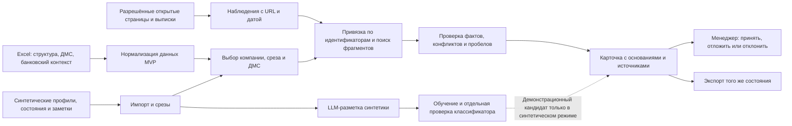

# MVP baseline без данных Банка

> Рабочее решение перед реализацией, 20.11.2026. Основа: [бриф](./brief.md), [USM](./usm.md), [ER](./er-diagram.md), [схема полей](./schema.xlsx), ответы представителя заказчика, переданные пользователем. Числа и критерии ниже, если не снабжены источником, — предлагаемый размер демонстрационного набора, а не требования заказчика.

## 1. Результат и граница достоверности

**Результат:** менеджер открывает компанию и видит карточку «ДМС стоит рассмотреть, потому что…»: отдельно наблюдаемые факты, точные источники и даты, интерпретацию, противоречия и сведения, которые нужно проверить. Менеджер принимает, откладывает или отвергает подсказку с причиной. «Подходит», «вероятность покупки» и автоматическое коммерческое решение не показываются.

**Граница продуктов:** в MVP ДМС — единственный целевой НБС для покрытия, карточки и экспериментального классификатора. [Перечень продуктов в XLSX](./schema.xlsx) используется как источник структуры и будущего объёма поддержки, но остальные НБС не загружаются как анализируемые цели и не получают подсказок в MVP. Банковские продукты, если присутствуют в синтетическом профиле, могут показываться только как контекст клиента. После MVP поддержка других НБС из перечня расширяется по одному продукту после проверки его описания и контрольных кейсов; порядок и срок не заданы.

**Факт из переписки:** формальной матрицы применимости нет; страховая таблица — ориентир для менеджера. **Рабочее решение:** отсутствие матрицы не останавливает сбор фактов. **Расхождение:** исходное ТЗ содержит предиктивный NBO; при отсутствии клиентских исходов покупки его нельзя честно обучить или оценить. Синтетические исходы проверяли бы код генератора, а не качество рекомендаций на портфеле.

Показываем два строго разделённых режима:

1. **Синтетический сквозной сценарий:** вымышленные клиенты, продукты, подключения, два временных среза, заметки и источники внутри тестового набора. Здесь демонстрируются импорт, граф, карточка, сравнение и экспорт. Каждый факт помечен `synthetic`.
2. **Сценарий открытых фактов:** несколько реальных организаций, выбранных вручную по ИНН; только сведения, действительно полученные из разрешённых публичных источников. Их банковские продукты, отношения с ПСБ и статус клиента **неизвестны**. Этот режим демонстрирует поиск и атрибуцию, но не покрытие портфеля или cross-sell.

**Решение для реализации:** публичные организации и их факты хранятся в отдельном ресурсе, без FK на `clients` и без `client_product_states`. В интерфейсе режим выбирается явно; при переходе фильтры, карточка и экспорт получают контекст только выбранного режима. Локальный переключатель «администратор / анализ» показывает разные действия без входа и не является защитой API. Синтетический импорт фиксируется атомарно; исправление уже созданного среза порождает новый срез с ссылкой на исходный.

Нельзя соединять факт о реальной фирме с вымышленным клиентом по совпадению названия/ИНН, приписывать реальной фирме синтетическое подключение ДМС или выводить «ДМС отсутствует» из отсутствия публичной записи. Публичные сведения о компании и банковское состояние продукта — разные классы данных.

**Наполненность в синтетическом портфеле:** для выбранного среза и группы показываем числа с подтверждённым наличием НБС, подтверждённым отсутствием и неизвестным состоянием. Наблюдаемая доля подключений имеет знаменатель только из первых двух категорий и не выводится при нуле известных состояний; размер группы и число неизвестных показываются рядом. «Мало» означает лишь меньше наблюдаемых подключений в конкретном срезе и не является оценкой потребности, выгоды или перспективы продажи. На 12 демонстрационных компаниях сравнения регионов не представляют реальный портфель.

## 2. Выбор датасета: Kaggle или синтетика

**Решение: синтетика как основной датасет для ER; Kaggle не импортировать в MVP.** Рассмотрен [Santander Product Recommendation](https://www.kaggle.com/competitions/santander-product-recommendation/data): там помесячные записи о физических лицах, 24 банковских продуктах и задача предсказания следующего подключения; сам организатор предупреждает, что выборка не представляет реальных клиентов банка. Нет российских юрлиц, ИНН/КПП, ДМС, источников фактов и менеджерских решений. Условия использования привязаны к правилам соревнования. Переносить его в нашу ER путём переименования колонок означало бы выдумать основные связи. Набор можно использовать отдельно как учебный пример временных срезов, но он не является эталоном нашего кейса.

Проверка Kaggle не выявила подтверждённого набора, одновременно покрывающего корпоративных клиентов РФ, фактические подключения продуктов ПСБ, ДМС и происхождение текстовых свидетельств. Это **результат поиска**, а не доказательство отсутствия любого такого набора. Поиск других Kaggle-наборов не блокирует MVP: закрытые банковские связи всё равно пришлось бы синтезировать.

## 3. Реестр источников для MVP

| Источник | Что берём | Куда в ER | Режим и ограничение |
|---|---|---|---|
| [Схема заказчика](./schema.xlsx) | Названия полей, ДМС и перечень продуктов для расширения после MVP | `products`, структура профиля и состояний | Справочник структуры, **не клиентский датасет**. В MVP анализируемый НБС только ДМС; значения статусов и дат ещё требуют трактовки. |
| [ФНС: ЕГРЮЛ и «Прозрачный бизнес»](https://www.nalog.gov.ru/donline/) | ИНН, наименование, регистрационный статус, адрес/регион, ОКВЭД для выбранных реальных юрлиц | `clients`, `client_snapshot_profiles`, `source_observations`, `evidence_items` | Точечные выписки/страницы с датой получения. Массовая интеграционная выгрузка имеет отдельные условия и для MVP не нужна. |
| [ФНС: среднесписочная численность](https://www.nalog.gov.ru/opendata/7707329152-sshr2019/) | Численность за опубликованный отчётный год | `evidence_items` и при корректном сопоставлении `client_snapshot_profiles.employee_count` | Годовой показатель, а не текущая численность. Отсутствующая запись не означает ноль; ФНС описывает причины пропусков в [FAQ](https://www.nalog.gov.ru/rn77/opendata/respond/). |
| [ФНС: доходы и расходы](https://www.nalog.gov.ru/rn74/opendata/7707329152-revexp/) | Годовые суммы для контекста и контрольного кейса | `evidence_items` | Не подменять ими выручку за иной период и не делать автоматический вывод о финансовой пригодности продукта. |
| [ФНС: реестр МСП](https://www.nalog.gov.ru/opendata/7707329152-rsmp/) | Категория МСП, дата записи, доступные признаки | `evidence_items`, проверяемые атрибуты профиля | Реестр охватывает только МСП; отсутствие компании не доказывает, что она не существует. |
| [ПСБ: страница страхового брокера](https://www.psbank.ru/ecosystem/insurance-broker) | Публичное описание ДМС для организаций и предлагаемых услуг | `products`, `data_sources`, продуктовые текстовые фрагменты | Контекст продукта для цитирования; рекламное описание не является матрицей применимости. Проверить актуальность страницы при загрузке. |
| Официальный сайт выбранной компании | Фрагменты об офисах, команде, производстве, логистике — только если они реально опубликованы | `source_observations`, `evidence_items` | Ручной список URL, дата доступа и точный фрагмент. Условия сайта проверить до автоматического сбора; отсутствие сведений не трактовать как отсутствие деятельности. |
| [СПАРК-Интерфакс](https://spark-interfax.ru/license-agreement) | **Не входит в открытый baseline** | — | Доступ и использование зависят от договора; при появлении законного доступа можно добавить как отдельный адаптер источника. |

Для каждого источника фиксировать `source_name`, `canonical_locator`, `locator`, `as_of_date` (дата, к которой относится факт), `observed_at` (когда мы его получили), версию/хеш сохранённого фрагмента и точный текст. Для официальных открытых наборов ФНС действуют [типовые условия использования](https://www.nalog.gov.ru/files/tipovye_usloviya_od.pdf); перед автоматической загрузкой проверяем актуальную версию условий и объём набора. Сайт компании и СПАРК под эти условия не подпадают.

## 4. Что синтезируем по ER

**Предлагаемый минимальный набор:** 12 вымышленных юридических лиц, 2 среза, ДМС как единственный целевой НБС, разные состояния его подключения и несколько десятков заметок/фактов. Банковские продукты из [схемы заказчика](./schema.xlsx) допустимы как контекст клиента; другие НБС не включаются в анализ MVP. Это размер для прохода по сценариям, не нагрузочный тест и не имитация портфеля ПСБ. Генератор должен быть детерминированным (`seed`, версия генератора), а его выход — доступным для повторной сборки. Не создавать «псевдореальные» названия и ИНН, которые можно случайно принять за публичную организацию; идентификаторы явно начинаются с `DEMO-`, а любые проверочные ИНН остаются исключительно внутри синтетического режима и никогда не отправляются во внешние поиски.

| Группа ER | Наполнение baseline |
|---|---|
| `dzos`, `products` | ДМС и нужные для демо банковские продукты как контекст из схемы; остальной перечень НБС сохраняется в источнике для расширения после MVP. Недостающие атрибуты — `unknown`, а не выдуманные факты о ПСБ. |
| `clients`, `data_snapshots`, `client_snapshot_profiles` | Детерминированные вымышленные клиенты и два среза с явно известной датой; город, сегмент, активность и численность только как `synthetic`. |
| `product_snapshot_states`, `client_product_states` | Искусственно заданные подключения, отключения и отсутствие записи; **не смешивать** «нет продукта» с «нет данных о продукте». Текущий nullable `is_present` уже различает `false` и `NULL`; отсутствие строки тоже трактуется как неизвестность. |
| `data_sources`, `source_observations`, `evidence_items` | Синтетические заметки в первом режиме; реальные URL/фрагменты во втором. У каждого факта известны тип, дата и режим; несопоставленное не присоединяется к клиенту. |
| `recommendation_runs`, `recommendations`, `recommendation_evidence`, `recommendation_feedback` | Воспроизводимые карточки с `consider`, `insufficient_data` или `caution`, явными пробелами и привязкой использованных фактов. Обратная связь менеджера — тестовая и не обучает модель. |
| `product_bundles` и условные `applicability_*` | Не нужны для доказательства карточки ДМС. Связки можно показать только как наблюдаемую совместную встречаемость в синтетике; формальные правила не заполнять из страховой памятки. |

Исходное ТЗ упоминает 12-значный ИНН, хотя выбранный сценарий касается юрлиц. [ФНС указывает](https://www.nalog.gov.ru/rn77/fl/interest/inn/), что ИНН юрлица состоит из 10 цифр; для реальных компаний проверяем 10 цифр и контрольную сумму. Кроме того, `source_client_id` не является идентификатором ФНС, а `employee_count` из ФНС имеет собственный год наблюдения.

## 5. Как работает подсказка без обучения модели

1. Выбрать клиента и ДМС. Получить состояние продукта из **соответствующего режима данных**. Если состояние неизвестно, так и показать.
2. Найти факты: по ключам/полям и текстовому поиску в ограниченном, разрешённом корпусе. Для реальной компании связывать сведения по ИНН/ОГРН и проверять название; совпадения по одному названию недостаточно.
3. Отобрать факты с датой, точной ссылкой и надёжной привязкой. Противоречивые и старые сведения не удалять молча, а показывать как ограничения.
4. Сформировать текст по проверяемому шаблону: «ДМС стоит рассмотреть, потому что [факт и источник]. Неизвестно [пробелы]. Проверьте [вопросы]». Публичная страница ПСБ объясняет назначение продукта, но не доказывает потребность конкретной компании.
5. Если нет персональных проверяемых фактов, показать `insufficient_data`; если есть подтверждённое предостережение, `caution`. Не вычислять балл пригодности или вероятность покупки.

**RAG:** стартовый retrieval — фильтры по структурированным полям и полнотекстовый поиск с точными ссылками. Векторизация оправдана только если на одном и том же наборе контрольных вопросов она находит нужные фрагменты лучше этого baseline и сохраняет корректную атрибуцию. Для малого корпуса из нескольких страниц и записей отдельная модель не является предпосылкой. Возможная LLM перефразирует найденные факты, но итоговая карточка должна проверять, что каждое фактическое утверждение опирается на найденный фрагмент.

## 6. Эксперимент: классификатор кандидатов НБС на синтетике

**Цель эксперимента:** показать полный ML-пайплайн на демонстрационных данных: подготовка примеров → разметка → обучение → вывод кандидатов → отображение в карточке. Классификатор предлагает, какой НБС **стоит вынести менеджеру на рассмотрение**, и может вернуть «данных недостаточно». Он не определяет проверенную применимость, потребность или вероятность покупки. Работающий поиск фактов и карточка из раздела 5 не зависят от классификатора.

**Данные и разметка:** ДМС берётся из [схемы заказчика](./schema.xlsx), его публичное описание — из проверенного источника с URL и датой доступа. Это контекст для разметки, а не официальная матрица правил. Синтезировать профили и текстовые свидетельства разной полноты, включая отрицательные и противоречивые случаи; каждый пример помечать `synthetic`. LLM может предложить метку-кандидат для ДМС и основание по доступным фрагментам. Сохранить версию промпта, модели, исходного примера, предложенной метки и ручных исправлений. Не включать в признаки классификатора ответ LLM, её объяснение или сведения, которых нет у менеджера в момент анализа.

**Первый объём:** 12 компаний и два среза из раздела 4 нужны для сквозного показа, но сами по себе недостаточны для обучения и проверки классификатора. Для ML-эксперимента нужен отдельный синтетический корпус; его объём выбирается после составления классов и независимых проверочных кейсов, без выдуманного порога качества. Демонстрационный сценарий остаётся сосредоточен на ДМС; для него допустимы метки `consider`, `insufficient_data`, `caution`. Переход к нескольким НБС — отдельное расширение после проверки публичных описаний и наличия различимых кейсов для каждого продукта. Отсутствие записи о подключении не размечать как подтверждённое отсутствие продукта.

**Проверка:** сравнить классификатор с простым правилом/шаблоном на одинаковых примерах. Отдельно составить вручную кейсы, не использованные при генерации и LLM-разметке обучения; разделять обучающую и проверочную выборки по синтетическим компаниям и шаблонам генерации, чтобы близкие варианты одного случая не попадали в обе. Проверить ложные подсказки, пропущенные кандидаты, воздержание при нехватке данных и сохранность ссылок на факты. Метрики на синтетике показывают лишь поведение прототипа в заданных сценариях, не качество рекомендаций на портфеле Банка.

**Место в реализации:** после сквозного пути «источник → факт → карточка → экспорт» обучить первый простой классификатор как подключаемый модуль. В интерфейсе явно отделить его демонстрационный кандидат от наблюдаемых фактов и решения менеджера. Если он не улучшает демонстрационные кейсы по сравнению с простым правилом или часто теряет возможность воздержаться, карточка остаётся без ML-подсказки.

## 7. Сквозной пайплайн: от входных данных до решения менеджера

**Подготовка, выполняется заранее:**

1. Из [схемы заказчика](./schema.xlsx) извлечь поля и запись ДМС; остальной перечень НБС оставить для этапа после MVP. Для ДМС отдельно сохранить проверенное публичное описание с URL и датой. Описание объясняет назначение продукта, но не задаёт применимость к компании.
2. Детерминированно создать синтетические компании `DEMO-*`, два среза, профили, состояния продуктов и заметки. Импортировать их в `clients`, `data_snapshots`, `client_snapshot_profiles`, `client_product_states` и связанные таблицы. Зафиксировать режим `synthetic`, версию генератора и ошибки импорта. `false` для продукта допустимо только как явно заданное отсутствие в полном синтетическом срезе; пустое значение и отсутствие строки означают неизвестность.
3. Для режима открытых фактов вручную выбрать реальные компании и разрешённые URL. Сохранить исходный фрагмент, идентификатор организации, адрес страницы, дату факта и дату получения в отдельном наборе наблюдений. Не создавать для этих компаний вымышленные банковские подключения или статус клиента Банка; способ представления публичной организации в физической схеме надо зафиксировать до реализации этого режима.
4. **Отдельная экспериментальная ветка:** из синтетических профилей и доступных на момент анализа заметок собрать примеры для LLM-разметки; проверить часть меток вручную, обучить простой классификатор и проверить его на независимо составленных кейсах. Версии генератора, промпта, разметки и модели сохранить в манифесте эксперимента. Модель не обучается на публичных компаниях и обратной связи менеджера.

**Один запрос менеджера, выполняется при просмотре компании:**

1. Менеджер выбирает режим, компанию и дату среза; целевой НБС в MVP фиксирован как ДМС. Система загружает только записи этого режима; в открытом режиме банковское состояние продукта всегда `unknown`.
2. По точному идентификатору организации и выбранному срезу получить профиль и состояние продукта. Поиск фактов ограничить той же организацией и режимом: структурированные поля → текстовый поиск → извлечение фрагментов. Совпадения только по похожему названию не привязывать. Каждый фрагмент несёт `source_observation_id`, URL/локатор, `as_of_date`, `observed_at`, точный текст и хеш.
3. Проверить привязку, актуальность и противоречия. Отделить наблюдаемый факт о компании от общего описания ДМС. Для неподтверждённого или отсутствующего сведения сформировать явный пробел или вопрос менеджеру; отсутствие сведений не превращать в отрицательный факт.
4. Базовая логика формирует `consider`, `caution` или `insufficient_data` и текст карточки из отобранных фактов. `consider` означает повод изучить продукт, а не вывод о пригодности. Если включён экспериментальный классификатор, его кандидат показывается **отдельным полем** и только для синтетического режима; при расхождении с базовой логикой показываются оба результата, а факты не подменяются предсказанием.
5. Сохранить воспроизводимый запуск (`recommendation_runs`: срез, продукт, `pipeline_version`, при включённом эксперименте — `model_version`) и карточку (`recommendations`: базовый статус и отдельный `ml_candidate_status`) со связями на использованные `evidence_items` через `recommendation_evidence`. Версия модели отсылает к манифесту обучения. Не добавлять в карточку фактическое утверждение без связанного исходного фрагмента.
6. Интерфейс и экспорт показывают один и тот же результат: компанию и срез, статус и происхождение кандидата, проверяемые факты с ссылками и датами, интерпретацию, противоречия, неизвестное и вопросы для проверки. Менеджер принимает, откладывает или отклоняет подсказку с причиной; это сохраняется в `recommendation_feedback` и не запускает автоматическое переобучение.

**Критерий готовности пайплайна к следующему этапу:** четыре контрольных кейса ниже проходят весь путь с правильным режимом данных и открываемыми источниками; повторный запуск на тех же входах и версии pipeline даёт тот же результат. Оценка эффекта по времени работы менеджера остаётся отдельной проверкой, а метрики синтетического классификатора не выдаются за качество на реальных клиентах.

## 8. Контрольные кейсы и готовность к коду

До кода зафиксировать ожидаемый вывод для четырёх кейсов: (А) в синтетике есть сведения о персонале, ДМС не подключён; (Б) сведения о персонале есть, состояние ДМС неизвестно; (В) источники противоречат или устарели; (Г) источник с похожим названием не связан с выбранной компанией. В А допустимо «стоит рассмотреть» с пробелами; в Б нельзя утверждать отсутствие ДМС; в В показываются конфликт и `caution`; в Г факт не попадает в персональную карточку. Каждый кейс должен пройти путь источник → факт → карточка → экспорт и ручную проверку ссылки.

**Первая последовательность реализации:** синтетический генератор и импорт → схема снимков/источников → карточка клиента и покрытия → retrieval с точной атрибуцией → шаблон подсказки и воздержание → обратная связь → экспорт → сравнение двух срезов. После сквозной проверки карточки можно параллельно провести эксперимент с классификатором из раздела 6; он не блокирует базовый сценарий. Оценка пользы для менеджера проводится отдельно: одинаковые кейсы в текущем процессе и с прототипом, замер времени и ошибок привязки фактов. Порог эффекта пока не установлен.

**Решения перед DDL:** `is_present=false` означает подтверждённое отсутствие в полном синтетическом срезе; `NULL` или отсутствие записи означает неизвестность. Для реальных юрлиц применяется 10-значный ИНН, для вымышленных клиентов — ID `DEMO-*` без внешнего поиска. Список пробелов передаётся отдельной структурой/JSON по контракту, а URL, даты и хеш фрагмента сохраняются вместе с наблюдением.
